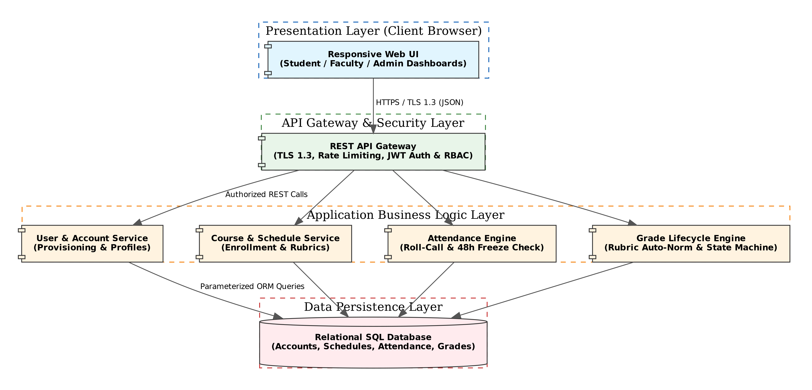

# Architecture

## Goals & Constraints

* **Primary Architectural Goals:**

  * High Responsiveness: $95\%$ of API requests processed in $< 800\text{ ms}$ under 500 active sessions (`SYS-NF-001`).
  * Concurrency: Support 200 concurrent attendance/grade submission transactions without database deadlock (`SYS-NF-002`).
  * Availability: Maintain $99.0\%$ operational uptime during active terms (`SYS-NF-003`).
  * Security & Confidentiality: Role-based data isolation (`PRJ-SO-001`) and strict workflow state integrity (`PRJ-SO-002`).

* **Architectural Constraints:**

  * Agile Timeline: Deliverable within 2 one-week Agile sprints by a 3-student development team.
  * No SMTP Infrastructure: Initial temporary credentials displayed on administrative UI views (`SYS-F-001`).
  * Immutable 48-Hour Freeze: Hard backend time check revoking faculty attendance edits 48h post-session (`SYS-F-010`).

## Stakeholders & Concerns

| Stakeholder | Primary Architectural Concerns |
| :--- | :--- |
| **Students** | Fast response times ($< 800\text{ ms}$), clear UI, grade privacy, transparent regrade dispute tracking. |
| **Faculty** | Effortless roll-call ($\le 3$ clicks), clear roster visibility, rubric grade submission. |
| **Administrators** | System-wide visibility, operational overrides, account management, institution metrics export. |
| **Evaluators / QA** | Clean layer separation (3-tier), automated test coverage ($\ge 70\%$), security compliance. |

## Component Diagram
The system is structured into cohesive components separated across Presentation, API Gateway, Application Business Logic, and Persistence layers.

{width=85%}

## Component Descriptions

* **Web UI Presentation Component:** Responsive Single Page Application (SPA) providing role-tailored dashboards for Students, Faculty, and Administrators.
* **API Gateway & Auth Middleware:** Handles TLS 1.3 termination, rate limiting, JWT session validation (48h expiry), and RBAC endpoint middleware (`PRJ-SR-001`..`004`).
* **User & Account Service:** Manages administrative user provisioning, role assignments, temporary credential resets, and contact details updates.
* **Course & Schedule Service:** Handles course offerings, section capacity management, rubric scheme auto-normalization, student self-enrollment (max 6), and class schedule publishing.
* **Attendance Engine:** Manages digitized roll-call entry, enforces the strict 48-hour modification freeze constraint, and processes administrative overrides.
* **Grade Lifecycle Engine:** Manages numeric rubric evaluations, state transitions (`Draft` $\rightarrow$ `Submitted` $\rightarrow$ `Under Review` $\rightarrow$ `Published`), and regrade dispute workflows.
* **Persistence Layer:** Relational database management system with parameterized ORM queries preventing SQL injection (`PRJ-SR-005`).

## Chosen Architecture Pattern and Rationale
The system adopts a **Classic 3-Tier Layered Architecture** (Presentation, Application/Logic, Data Persistence).

* **Rationale:** A monolithic 3-tier layered architecture offers clear separation of concerns, simplifies local deployment, minimizes network hop latency ($< 800\text{ ms}$ target), and fits perfectly within the 2-week implementation window of a 3-student team. Microservices were explicitly rejected due to deployment overhead and distributed transaction complexity.

## Technology Stack & Data Stores

* **Frontend:** HTML5, CSS3 (Flexbox/Grid), Modern JavaScript (React/Vue/Vanilla ES6).
* **Backend Application Server:** Node.js (Express) or Python (FastAPI/Flask).
* **Database Management System:** PostgreSQL or MySQL relational database using ORM (Prisma/SQLAlchemy).
* **Security & Auth:** TLS 1.3, bcrypt password hashing (factor 12), HTTP-only JWT bearer tokens.

## Risks & Mitigations

| Risk | Impact | Likelihood | Mitigation Strategy |
| :--- | :--- | :--- | :--- |
| Database connection pool exhaustion during peak roll-calls | High | Medium | Implement connection pooling, index `session_id` and `student_id` fields, load test for 200 concurrent POSTs. |
| Unauthorized attendance edits after 48 hours | High | Low | Enforce 48-hour timestamp checks strictly in backend API middleware, independent of client UI logic. |
| Unbalanced rubric component weights | Medium | Low | Implement backend auto-normalization of component weights to sum to 100% on save (`SYS-F-005`). |

## Traceability to Requirements

| Requirement ID | Component / Module | Design Implementation |
| :--- | :--- | :--- |
| `SYS-F-001`..`004` | User & Account Service | REST endpoints `/api/v1/users`, temporary credential display screen, bcrypt hashing. |
| `SYS-F-005`..`008` | Course & Schedule Service | REST endpoints `/api/v1/courses`, self-enrollment cap logic (6 courses), schedule mapping. |
| `SYS-F-009`..`012` | Attendance Engine | REST endpoints `/api/v1/attendance`, 48h automated freeze middleware, admin override endpoint. |
| `SYS-F-013`..`017` | Grade Lifecycle Engine | REST endpoints `/api/v1/grades`, rubric auto-normalization, state machine handler. |
| `SYS-F-018`..`020` | Analytics Service | Consolidated dashboard SQL views, GPA calculation engine, metric CSV exporter. |

## Security Architecture (STRIDE Threat Model)

| Threat Category | Potential Threat | Architectural Mitigation |
| :--- | :--- | :--- |
| **Spoofing** | User credential theft / Session hijacking | Enforce TLS 1.3 transit encryption (`PRJ-SR-001`), bcrypt hashing (`PRJ-SR-002`), HTTP-only 48h JWTs (`PRJ-SR-003`). |
| **Tampering** | Parameter tampering of attendance or grade values | Parameterized ORM queries (`PRJ-SR-005`), server-side RBAC validation (`PRJ-SR-004`). |
| **Repudiation** | Disputed grade alterations or attendance changes | Rigid state machine transitions (`Draft` $\rightarrow$ `Published`), administrative override logging. |
| **Information Disclosure** | Unauthorized student grade/profile access | RBAC middleware enforcing strict tenant/role data isolation (`PRJ-SO-001`). |
| **Denial of Service** | API flooding during attendance roll-call | Rate limiting on API gateway endpoints, connection pooling, performance target $< 800\text{ ms}$. |
| **Elevation of Privilege** | Student attempting faculty or admin actions | Role claims embedded in signed JWTs and checked by backend middleware on every request (`PRJ-SR-004`). |
