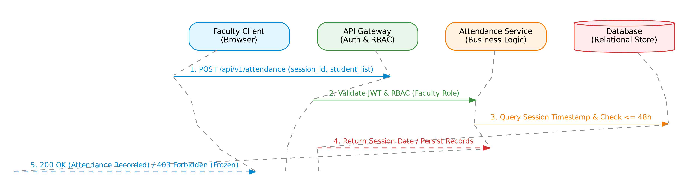
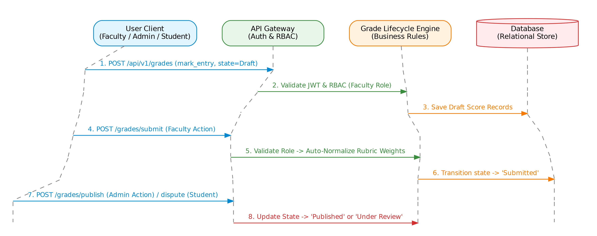

# Design

## Design Overview
The detailed design translates architectural components into specific modules, RESTful API endpoint contracts, sequence interaction models, error handling guidelines, and UI user-experience patterns.

## UML Sequence Diagrams

### Sequence Diagram 1: Digitized Attendance Marking & 48-Hour Freeze
The sequence below illustrates a Faculty member executing roll-call and the backend enforcing the 48-hour freeze constraint.

{width=90%}

\clearpage

### Sequence Diagram 2: Weighted Rubric Grade Lifecycle
The sequence below illustrates grade progression from `Draft` through `Submitted` and `Published`, including Student regrade disputes (`Under Review`).

{width=90%}

\clearpage

## API Design

### Component Interface 1: Attendance Marking Endpoint

* **Endpoint:** `/api/v1/attendance/sessions/{sessionId}`
* **Method:** `POST`
* **Headers:** `Authorization: Bearer <JWT>`, `Content-Type: application/json`
* **Request Body:**
  ```json
  {
    "session_id": "SESS-2026-101",
    "attendance_list": [
      { "student_id": "PES1UG22CS001", "is_present": true },
      { "student_id": "PES1UG22CS002", "is_present": false }
    ]
  }
  ```
* **Success Response (200 OK):**
  ```json
  {
    "status": "success",
    "message": "Attendance recorded for 2 students.",
    "frozen_at": "2026-10-14T10:00:00Z"
  }
  ```
* **Error Responses:**
  * `401 Unauthorized`: Missing or expired JWT token.
  * `403 Forbidden`: Attendance session is frozen (> 48 hours post-session start).
  * `404 Not Found`: Invalid session ID or student not enrolled in section.

### Component Interface 2: Grade Lifecycle & Dispute Endpoint

* **Endpoint:** `/api/v1/grades/courses/{courseId}/students/{studentId}`
* **Method:** `PUT`
* **Headers:** `Authorization: Bearer <JWT>`, `Content-Type: application/json`
* **Request Body:**
  ```json
  {
    "rubric_scores": [
      { "rubric_id": "RUB-01", "score": 85.0 },
      { "rubric_id": "RUB-02", "score": 90.0 }
    ],
    "target_state": "Submitted"
  }
  ```
* **Success Response (200 OK):**
  ```json
  {
    "status": "success",
    "weighted_total": 87.5,
    "grade_state": "Submitted"
  }
  ```
* **Error Responses:**
  * `400 Bad Request`: Rubric scores out of valid range (0-100).
  * `403 Forbidden`: User role unauthorized for target state transition.

## Error Handling, Logging & Monitoring

* **Error Handling:** Standardized REST error envelopes containing HTTP status code, machine-readable error codes, and human-readable messages.
* **Logging Standards:** Structured JSON logging (Winston/Pino or Python `logging`). Sensitive data (passwords, JWT tokens, personal contact details) are strictly sanitized and excluded from log streams.
* **Monitoring Metrics:** API latency metrics (tracking $< 800\text{ ms}$ threshold), error rates (5xx responses), and concurrent transaction counts.

## UX Design

* **Design System:** Clean, accessible web interface compliant with WCAG 2.1 AA accessibility guidelines.
* **Navigation Efficiency:** Key user workflows (taking roll-call, viewing student GPA) are reachable within $\le 3$ clicks from login.
* **Responsive Layout:** Optimized for devices ranging from mobile screens (375px) to desktop monitors (1920px).

## Open Issues & Next Steps

* **Future Work:** Evaluate automated batch notification options for dispute status updates.
* **Scalability Enhancements:** Implement Redis cache layer for course catalog queries if institution size exceeds 10,000 active students.
