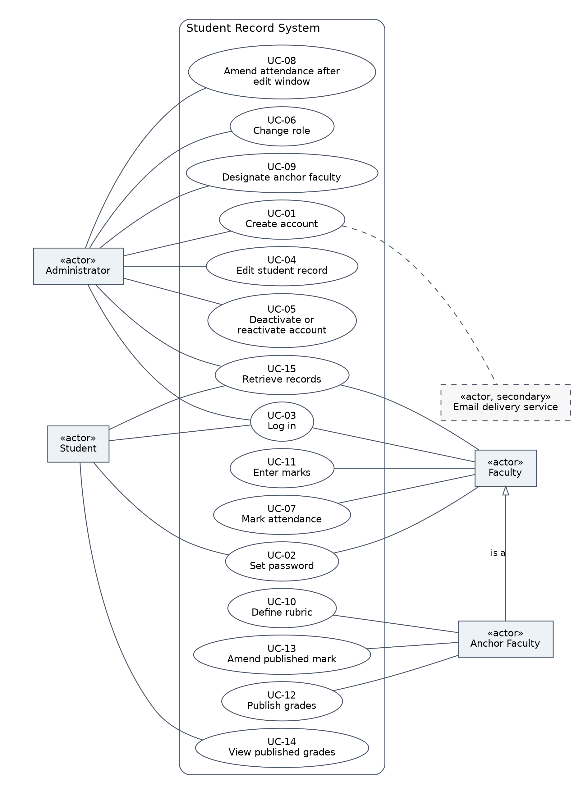
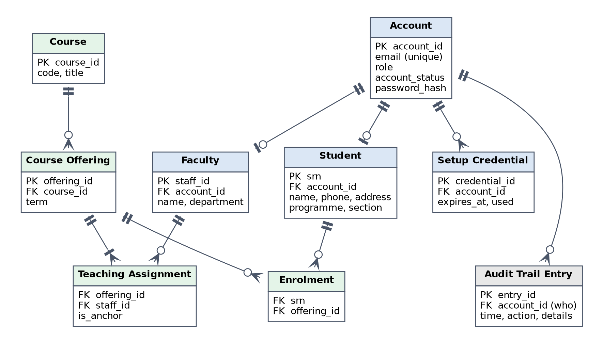
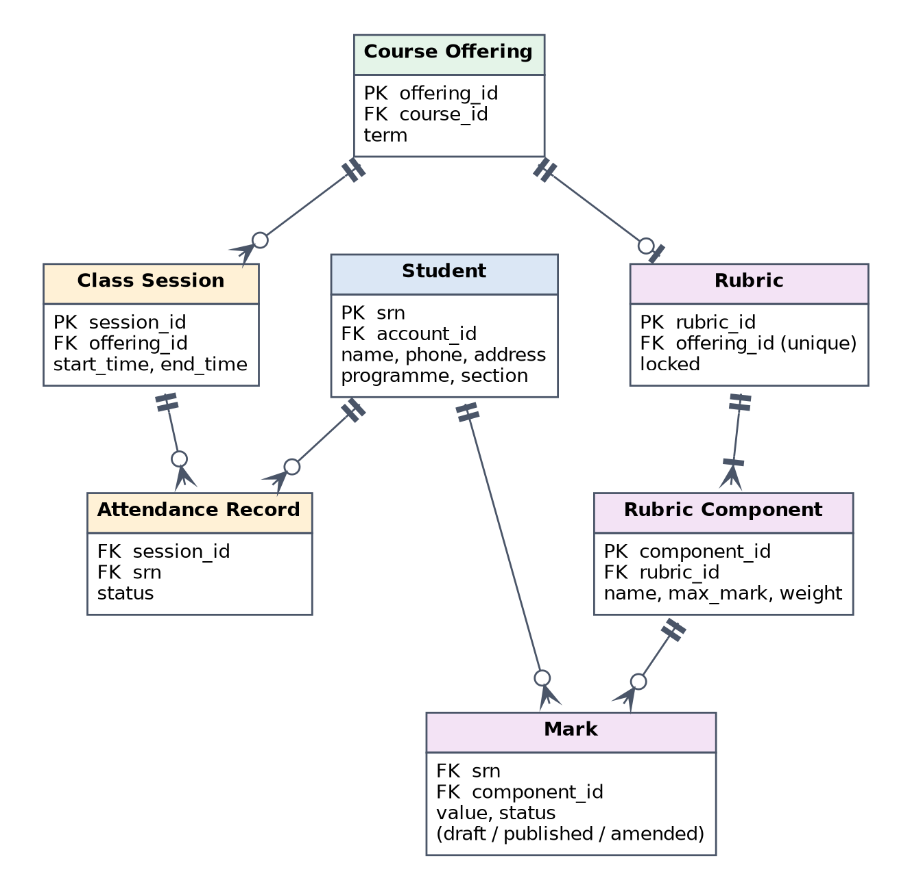
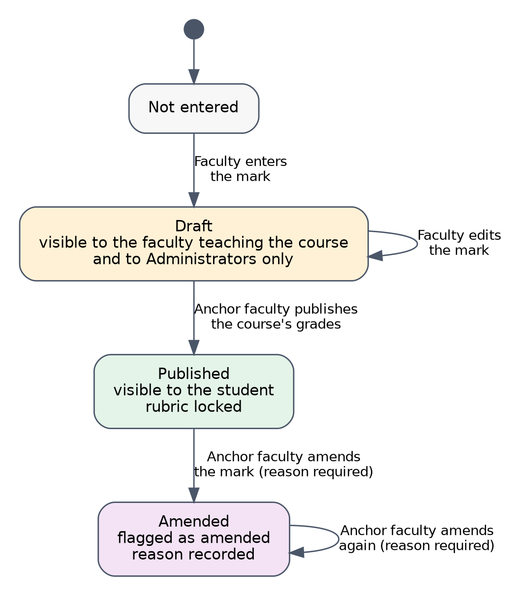
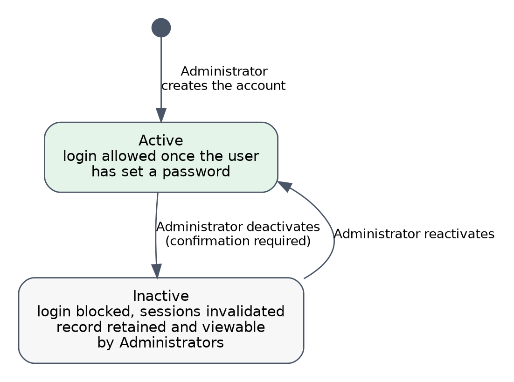

# Analysis Models

This section presents three kinds of model that analyse the requirements in Section 5 from different viewpoints: a use case diagram, which shows who does what with the system; entity-relationship diagrams, which show what data the system holds; and state diagrams, which show how two important items change over time. The models are conceptual. Field-level detail is in Appendix B, and the final database schema will be given in the design document.

## Use Case Diagram

The diagram below shows the actors and the use cases of the Student Record System.

{ width=100% }

The actors are the three user classes described in Section 2.3: Administrator, Faculty and Student. The Anchor Faculty is a Faculty member designated for a particular course, so it can do everything Faculty can, in addition to the use cases shown for it (the "is a" arrow). The email delivery service is a secondary actor, which takes part in account creation by delivering the setup credential.

Every use case except UC-02 and UC-03 requires the user to be logged in. In every use case, role-based access (Section 5.6) limits what the actor may do. For example, a Faculty member can mark attendance only for the courses they teach.

| ID | Use case | Actors | Summary | Section |
|---------|-------------|-------------|--------------------------------------|---------|
| UC-01 | Create account | Administrator; email delivery service | The Administrator creates a Student or Faculty account and assigns its role. The system sends the setup credential by email. | 5.1 |
| UC-02 | Set password | Student, Faculty | A new user sets their own password using the single-use setup credential. | 5.1 |
| UC-03 | Log in | Administrator, Faculty, Student | A user authenticates with email and password. Inactive accounts are refused. | 5.1, 6.3 |
| UC-04 | Edit student record | Administrator | The Administrator corrects or updates a student's details. Every edit is audited. | 5.2 |
| UC-05 | Deactivate or reactivate account | Administrator | The Administrator sets an account to Inactive, which blocks login but keeps the record, or reactivates it. | 5.2, 5.6 |
| UC-06 | Change role | Administrator | The Administrator changes an account's role between Student and Faculty. | 5.6 |
| UC-07 | Mark attendance | Faculty | A Faculty member marks attendance for a scheduled class session of a course they teach. | 5.3 |
| UC-08 | Amend attendance after edit window | Administrator | After the edit window has closed, the Administrator amends an attendance entry. The change is logged. | 5.3 |
| UC-09 | Designate anchor faculty | Administrator | The Administrator designates, or reassigns, the anchor faculty of a course from the faculty teaching it. | 5.4 |
| UC-10 | Define rubric | Anchor Faculty | The anchor faculty creates or alters the course's rubric, until its grades are published. | 5.4 |
| UC-11 | Enter marks | Faculty | A Faculty member enters marks against the rubric for the students in a course they teach. | 5.4 |
| UC-12 | Publish grades | Anchor Faculty | The anchor faculty publishes a course's grades, which makes them visible to students and locks the rubric. | 5.4 |
| UC-13 | Amend published mark | Anchor Faculty | After publication, the anchor faculty corrects a mark and records the reason. | 5.4 |
| UC-14 | View published grades | Student | A student views their own published grades. | 5.4 |
| UC-15 | Retrieve records | Administrator, Faculty, Student | A user searches for and views records, attendance and grades, limited to what their role allows. | 5.5 |

## Entity-Relationship Diagrams

The data model is shown in two diagrams so that each stays legible. Student and Course Offering appear in both. The notation is the crow's foot notation. A single bar means exactly one, a circle with a bar means zero or one, a circle with a crow's foot means zero or many, and a bar with a crow's foot means one or many. `PK` marks a primary key and `FK` a foreign key. Only the most important attributes are shown.

### Accounts and Course Structure

{ width=100% }

| Entity | Description |
|---------------|----------------------------------------------|
| Account | The login identity of a user: email, role, account status (Active or Inactive) and password hash. |
| Student | The student record (Section 5.2). Each student record belongs to one account. |
| Faculty | A faculty member's details, including Staff ID and department. Each belongs to one account. |
| Setup Credential | A single-use, time-limited token that lets a new user set their password. An account may have more than one over time, for example if one expires. |
| Audit Trail Entry | One entry for each recorded change or denied request, linked to the account that acted. An entry for a failed login by an unknown user has no account. Its exact structure is decided in the design document. |
| Course | A subject taught at the institution. |
| Course Offering | A course as taught in a particular term. |
| Teaching Assignment | Links a Faculty member to a course offering they teach. The `is_anchor` attribute marks the anchor faculty. |
| Enrolment | Links a student to a course offering. |

Constraints that the diagram does not show:

- Exactly one Teaching Assignment of each course offering is marked as the anchor faculty (REQ-GRD-001).
- SRN, Staff ID and email are each unique across the system (REQ-ONB-009).
- A student can be enrolled in a given course offering at most once, and a Faculty member can be assigned to a given course offering at most once.

### Attendance and Grading

{ width=85% }

| Entity | Description |
|---------------|----------------------------------------------|
| Class Session | A scheduled meeting of a course offering, at which attendance can be marked. How sessions are scheduled is TBD in Section 5.3. |
| Attendance Record | The attendance status of one student in one class session. |
| Rubric | The grading scheme of a course offering. A course offering has at most one rubric, which is locked once grades are published. |
| Rubric Component | One assessed item of a rubric, with a name, a maximum mark and a weight. |
| Mark | The mark of one student for one rubric component, with its status (draft, published or amended). |

Constraints that the diagram does not show:

- The weights of the components of a rubric add up to exactly 100% (REQ-GRD-004).
- A mark lies between 0 and its component's maximum mark (REQ-GRD-011).
- A student has at most one attendance record per class session and one mark per rubric component.
- A student cannot be marked present in two overlapping class sessions. The system enforces this rule across sessions (Section 5.3).

## State Diagrams

Two items follow rules that depend on their current state. The diagrams below make those rules explicit.

### Life Cycle of a Mark

{ width=70% }

- A mark starts as Not entered. Entering it makes it a Draft, which only the faculty teaching the course and Administrators can see (REQ-GRD-019).
- Faculty can keep editing a Draft. The rubric can still be changed, with a warning if marks already exist (REQ-GRD-006).
- When the anchor faculty publishes the course's grades, all its marks become Published. They are then visible to the students, and the rubric is locked (REQ-GRD-018, REQ-GRD-006).
- After publication, only the anchor faculty can amend a mark, and must give a reason. The mark is then flagged as Amended, and can be amended again in the same way (REQ-GRD-021).

### Status of an Account

{ width=70% }

- An Administrator creates an account, which starts as Active (REQ-ONB-011). The user can log in once they have set a password (REQ-ONB-018).
- Only an Administrator can deactivate an account, after confirming the action. An Inactive account cannot log in, and its sessions are invalidated. Its record, attendance and grades are retained and stay viewable by Administrators (REQ-REC-009, REQ-REC-010, REQ-RBAC-018, REQ-RBAC-019).
- An Administrator can reactivate the account, which restores the user's ability to log in (REQ-REC-011).