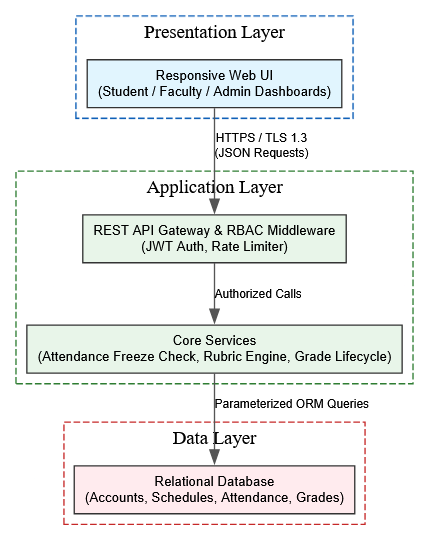
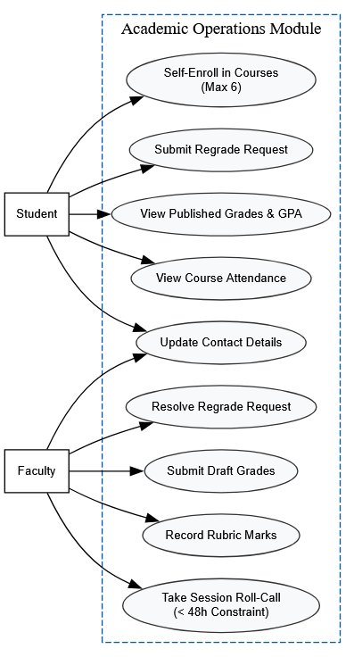
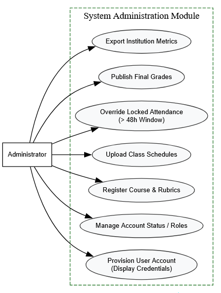

# System Models & Diagrams

## Architectural Model
The application follows a standard 3-tier architecture separating user interface presentation, server-side business logic, and database persistence.

## Data Entity-Relationship Model
The entity-relationship model defines user accounts, course offerings, class schedules, roll-call attendance logs, and weighted rubric grades.

## Grade Lifecycle State Machine
Grades progress through a controlled state machine ensuring visibility restrictions and dispute tracking.

## UML Use-Case Diagrams

### Academic Operations Use-Case Diagram
Covers primary operational interactions executed by Students and Faculty.

### System Administration Use-Case Diagram
Covers administrative provisioning, course setup, schedule creation, and grade publication.

