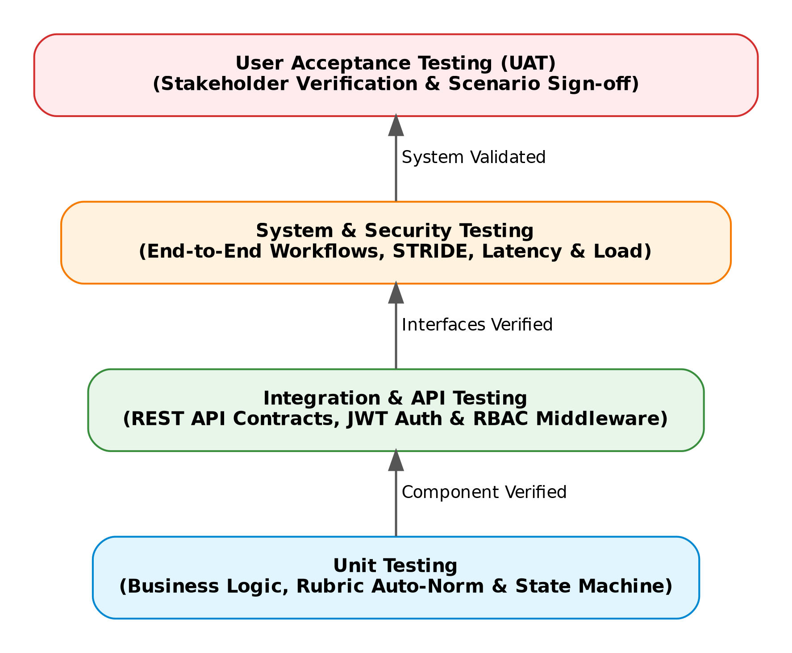

# 5. Test Approach / Strategy

## Levels
Testing executes across four hierarchical verification levels:

{width=85%}

\clearpage

* **Unit Tests:** Verify component functions, rubric weight auto-normalization algorithms, GPA calculation logic, and state machine transition rules.
* **Integration Tests:** Verify REST API endpoints, ORM data mappers, authorization middleware, and relational database queries.
* **System Tests:** Validate full end-to-end user workflows across Presentation, Application, and Persistence layers.
* **Acceptance Tests (UAT):** Conduct scenario verification with evaluators for Student, Faculty, and Admin roles.

## Types

* **Functional Testing:** Core business logic verification against functional requirements `SYS-F-001` through `SYS-F-020`.
* **Regression Testing:** Automated test execution on every commit to ensure existing functionality remains unbroken.
* **Performance Testing:** Load testing verifying API response time $\le 800\text{ ms}$ under 500 active sessions and 200 concurrent transactions.
* **Usability Testing:** Accessibility and workflow efficiency evaluation ($\le 3$ clicks to complete roll-call).

## Entry Criteria

* Baseline application build deployed to the test environment.
* Database schema migrated and seeded with synthetic test data.
* Test suites and API scripts verified against OpenAPI specifications.

## Exit Criteria

* 100% of planned automated test cases executed.
* 100% of functional requirements (`SYS-F-001`..`020`) verified and passed.
* 0 critical or high-severity open defects.
* Performance tests confirm $95\%$ API response time $< 800\text{ ms}$ and 200 concurrent transaction capability.
* Security verification confirms TLS 1.3, bcrypt hashing, 48h JWT expiration, and zero SQLi/XSS vulnerabilities.
* Automated code coverage meets or exceeds $70\%$.

\clearpage

## 5.1 Security Validation

* **Credential & Password Security:** Validate temporary credential generation, forced password reset on first login, and bcrypt password hashing (factor 12) (`PRJ-SR-002`).
* **Session Security:** Verify HTTP-only JWT token issuance, payload signing, and automated token invalidation post-48 hours (`PRJ-SR-003`).
* **Transit Encryption:** Ensure TLS 1.3 encryption is strictly enforced across all REST API endpoints (`PRJ-SR-001`).
* **Access Control (RBAC):** Execute role matrix verification ensuring Student, Faculty, and Admin role permissions are strictly checked by middleware (`PRJ-SR-004`).
* **Input Fuzzing & SQLi Protection:** Validate parameterized ORM queries against SQL injection and cross-site scripting (XSS) using OWASP ZAP automated scanners (`PRJ-SR-005`).
* **Automated Freeze Lock:** Verify backend API time validation rejects Faculty attendance edits exactly 48 hours post-session start (`SYS-F-010`).
