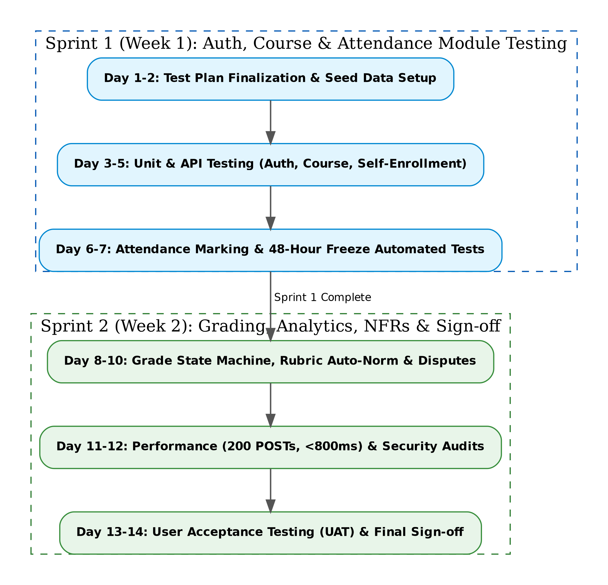

# 7. Test Schedule

Testing activities are integrated directly into two 1-week Agile development sprints:

{width=85%}

\clearpage

## Milestones

* **Test Plan & Matrix Finalization:** 15-09-2026
* **Test Environment & Seed Data Setup:** 18-09-2026
* **Sprint 1 Execution Start (Auth, Course, Attendance):** 20-09-2026
* **Sprint 1 Execution End:** 27-09-2026
* **Sprint 2 Execution Start (Grading, Analytics, NFRs):** 28-09-2026
* **Sprint 2 Execution End:** 05-10-2026
* **User Acceptance Testing (UAT):** 08-10-2026 to 10-10-2026
* **Final Sign-off:** 12-10-2026
